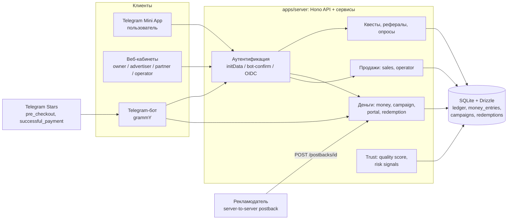
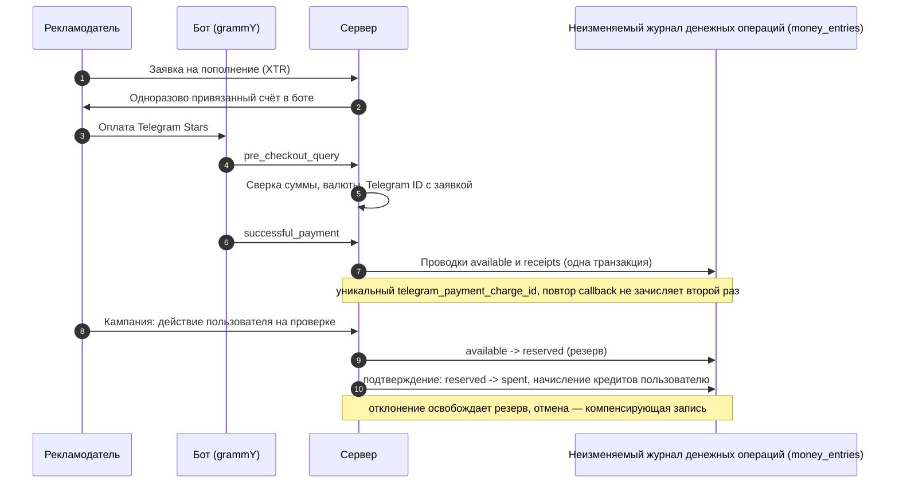
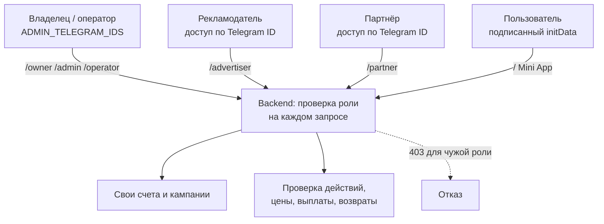

# GiftQuest — кейс-витрина

> **English summary.** GiftQuest is a Telegram Mini App where users complete verified quests, earn internal points and
> request Telegram Gifts; advertisers pay (Telegram Stars / TON) for verified actions. This repository is a
> *documentation-only showcase*: architecture, money-flow diagrams, key decisions and audited numbers. The product
> source code is private. Honest status: the product is deployed and running on a production VPS, real Stars payments
> are confirmed only for a single 1 XTR payment (document dated 2026-09-06), and **real Telegram Gift delivery is a
> stub** (the server refuses to start with `REAL_GIFT_REDEMPTION=true`). Every number below is linked to its source;
> claims I could not confirm are listed separately in [docs/NOT_CONFIRMED.md](docs/NOT_CONFIRMED.md).

Исходники продукта приватные. Здесь только описание, схемы и проверенные цифры. Источники цифр — в
[docs/EVIDENCE.md](docs/EVIDENCE.md); дата аудита — **2026-10-11** (`STATUS_REPORT.md`, режим read-only).

---

## 1. Проблема и для кого

**Что это.** Dark-only Telegram Mini App: пользователь выполняет проверяемые задания (квесты), получает внутренние
кредиты и отслеживает прогресс к Telegram Gift; запрос Gift оформляется как заявка на ручное исполнение
(`README.md` и `AGENTS.md` исходного репозитория).

**Модель.** Рекламодатель платит за подтверждённые действия; часть стоимости возвращается пользователю в виде кредитов
(`AGENTS.md`: «Advertisers pay for verified actions»; `docs/FINANCIAL_MODEL.md`: `grossMargin = advertiserPayout - userRewardCost`).

**Для кого (роли, подтверждены кодом/документами):**

| Роль | Что делает | Где подтверждено |
|---|---|---|
| Пользователь | Квесты, опросы, рефералы, заявка на Gift | `apps/web/src/screens`, `docs/TEST_LAUNCH_HANDOFF.md` |
| Рекламодатель | Пополняет счёт Stars/TON, создаёт черновик кампании, видит статистику | `docs/COMMERCIAL_MVP.md` (`/advertiser`) |
| Партнёр (источник трафика) | Именованные ссылки, начисления с 14-дневным удержанием | `docs/COMMERCIAL_MVP.md` (`/partner`) |
| Оператор / владелец | Согласует цены, подтверждает/отклоняет действия, ведёт продажи, исполняет Gift вручную | `docs/COMMERCIAL_MVP.md` (`/owner`, `/admin`), `STATUS_REPORT.md` §2.1 (`/operator`) |

Гипотеза рынка (из `docs/sales-system.md`, помечено в самом документе как частично устаревшее): первичный ICP
рекламодателей — Telegram Mini App-игры и игровые боты RU/CIS команд на 1 000 – 50 000 MAU. Подтверждения спроса
(платящие рекламодатели, выручка) в документах **не найдено** — см. [NOT_CONFIRMED](docs/NOT_CONFIRMED.md).

## 2. Как устроено

Modular monolith на Node.js/TypeScript: React + Vite (Mini App и кабинеты), Hono (API), grammY (бот), SQLite + Drizzle
(хранилище), общие Zod-схемы в `packages/shared` (`AGENTS.md`, раздел Architecture).

### 2.1 Контуры системы

### 2.2 Поток денег: Stars → неизменяемый журнал денежных операций (money_entries)

Схема собрана по `docs/COMMERCIAL_MVP.md`, `docs/LAUNCH_AUDIT_CURRENT.md`, `docs/ADVERTISER_INTEGRATION.md`
и схеме `packages/db/src/schema/commercial.ts`.

### 2.3 Роли и границы доступа

### 2.4 Как это работает для пользователя

Пользователь видит каталог Telegram-подарков, по каждому показан прогресс до получения (баланс / цена, баланс из append-only журнала). В каталоге сейчас восемь подарков; есть карточка каждого подарка с прогресс-баром и детальная страница выбранного подарка. В детальной странице показаны цена, баланс и прогресс. Каталог и карточки: `apps/web/src/screens/GiftMarketScreen.tsx:10-45`, `apps/web/src/components/GiftCard.tsx:22-23,49-72`; детали: `apps/web/src/screens/GiftDetailsScreen.tsx:41-124`; визуальный компонент прогресса: `apps/web/src/components/GiftProgress.tsx:11-55`.

Прогресс не хранится отдельно: он вычисляется из доступного баланса (`spendablePoints`) — суммы append-only журнала — по формуле `ratio = min(spendable / pricePoints, 1)`, процент: `floor(spendable * 100 / pricePoints)`, остаток: `max(0, pricePoints - spendable)`. При `spendable >= pricePoints` подарок доступен; некорректная или неположительная цена считается полностью покрытой. Формула: `packages/shared/src/gift-progress.ts:3-7,27-50`; получение баланса: `apps/server/src/app.ts:196-204,270-278`; передача в UI: `apps/web/src/App.tsx:334-335`.

При достаточном балансе пользователь может создать заявку через `POST /redemptions`: сервер проверяет доступность, резервирует подарок, списывает `pricePoints` и создаёт запись со статусом `reserved`. Запрос на клиенте: `apps/web/src/App.tsx:489-508`; маршрут: `apps/server/src/app.ts:732-776`; резервирование и списание: `apps/server/src/redemption-service.ts:221-289`.

Выдача не автоматизирована. Единственный транспорт — `FakeGiftTransport`, который не выполняет сетевых вызовов и не подключён к маршрутам резервирования (`apps/server/src/gift-transport.ts:16-25`). `REAL_GIFT_REDEMPTION=true` запрещён: с ним сервер не запускается (`apps/server/src/config.ts:258-268`). Администратор вручную помечает заявку отправленной через `POST /admin/redemptions/:id/sent` (`apps/server/src/admin-routes.ts:331-351`).

**Со слов владельца:** «пользователь выбирает любой Telegram-подарок и видит прогресс до его получения».

В коде подтверждены каталог и прогресс по каждому из восьми подарков. Не подтверждено, что это «любой» подарок из всего каталога Telegram: клиент показывает фиксированный shortlist из восьми ID (`apps/web/src/App.tsx:66-72,145-150`; `packages/shared/src/curated-gifts.ts:1-8`).

## 3. Ключевые решения и почему

Только то, что нашёл в документах/коде. Для каждого решения указан источник.

| Решение | Почему (по документам) | Источник |
|---|---|---|
| Modular monolith, одна SQLite | В документах явно не обосновано; зафиксировано правило «продуктовая логика вне UI-кода». Контекст: проект ведёт один человек (`docs/sales-system.md`: «solo-founder») | `AGENTS.md` |
| Журнал баллов только добавляется: награды — положительные строки, отмены — отдельные отрицательные; баланс = сумма журнала | Прозрачная сверка, нет «тихой» правки баланса. Баланс может уйти в минус (модель долга) — будущие начисления гасят долг | `docs/FINANCIAL_MODEL.md`, `docs/ADVERTISER_INTEGRATION.md` |
| Неизменяемый журнал денежных операций (money_entries) рекламодателей защищён на уровне БД: триггеры `BEFORE UPDATE/DELETE` с `RAISE(ABORT, 'Money journal is immutable')`; исправления — компенсирующие проводки | Запрет правки истории денег | `packages/db/migrations/0017_narrow_masque.sql`, `docs/COMMERCIAL_MVP.md` |
| Суммы — целые минимальные единицы; XTR и TON не конвертируются и не суммируются | Исключить ошибки округления и ложную «прибыль» | `docs/COMMERCIAL_MVP.md`, CHECK `money_amount_integer` в схеме |
| Идемпотентность денег на уровне уникальных индексов: `money_entry_operation`, `money_request_idempotency`, `money_request_telegram_charge`, `telegram_star_payments_charge_unique`, `gift_redemptions_user_idempotency_unique` | Повтор callback/запроса не должен дублировать деньги | `packages/db/src/schema/commercial.ts`, `schema/index.ts` |
| Stars зачисляются только после `pre_checkout_query` + `successful_payment` с проверкой суммы/валюты/плательщика | Клиентским данным не доверяем | `docs/COMMERCIAL_MVP.md`, `docs/LAUNCH_AUDIT_CURRENT.md`, `apps/server/src/telegram-bot.ts` |
| Награда пользователю — только по server-to-server postback с `click_id`; клиентских данных недостаточно | Защита от подделки | `docs/ADVERTISER_INTEGRATION.md` |
| Возвраты/реверсы принимаются и после окна атрибуции (72 ч по умолчанию) | Чтобы chargeback нельзя было «переждать» | `docs/ADVERTISER_INTEGRATION.md` |
| Партнёрское вознаграждение удерживается 14 суток; реферальные награды — до 3 подтверждённых действий приглашённого или 14 суток | Снижение риска накрутки | `docs/COMMERCIAL_MVP.md`, `docs/FINANCIAL_MODEL.md` |
| Выдача Gift — ручная; реальная доставка запрещена конфигом: сервер не стартует с `REAL_GIFT_REDEMPTION=true` | Честность: не делать вид, что флаг что-то включает | `apps/server/src/config.ts:258-267`, `docs/GIFT_REDEMPTION_MODEL.md` |
| Сетевые вызовы не внутри `BEGIN IMMEDIATE`; неоднозначный ответ доставки → `awaiting_reconciliation`, без авто-ретрая и авто-возврата | Не допустить двойной траты (Gift мог уйти, ответ потерян) | `docs/GIFT_REDEMPTION_MODEL.md` |
| Quality Score — детерминированный, только для просмотра админом, никогда не банит автоматически; IP/UA хранятся как HMAC-SHA-256 | Слабый сигнал, не приговор; приватность | `docs/QUALITY_AND_RISK.md` |
| Каталог Telegram-подарков: по каждому показан прогресс до получения (баланс / цена, баланс из append-only журнала) | Упрощение первого экрана | `packages/shared/src/index.ts:80-83`, `apps/web/src/components/GiftCard.tsx:22-72`, `docs/TEST_LAUNCH_SPEC.md` §1 |
| Casino/GameFi-эстетика запрещена в дизайне; гемблинг/беттинг/казино-рекламодатели — DISQUALIFY | Позиционирование и риск | `docs/TEST_LAUNCH_SPEC.md:400`, `docs/sales-system.md:122`, `docs/sales-rules.md:234` |

## 4. Результаты и цифры

Полная таблица с источниками и датой — [docs/EVIDENCE.md](docs/EVIDENCE.md). Кратко:

| Показатель | Значение | Источник |
|---|---|---|
| Тесты (`vitest run`, 117 файлов) | 1392 passed, 2 failed, 3 skipped | `STATUS_REPORT.md` §1.3, §2.3 (2026-10-11) |
| Причина 2 падений | `EPERM`/таймаут Windows во временных каталогах — **предположение** отчёта; логика продукта не затронута | там же |
| `tsc --noEmit` | чисто (exit 0) | `STATUS_REPORT.md` §2.3 |
| `biome check` | 426 ошибок категории format (CRLF) — **предположение** | `STATUS_REPORT.md` §2.3 |
| Коммиты в ветке `test-launch` | 226 (первый — 2026-08-25, HEAD `4dde6e7`, 2026-09-24) | `git rev-list --count HEAD`, `git log` (проверено при подготовке витрины) |
| Миграции БД | 27 (`0000`–`0026`) | `packages/db/migrations` |
| Серверные модули | ≈35 в `apps/server/src` | `STATUS_REPORT.md` §2.1 |
| Прод | `giftquest.top` отвечает 200, `giftquest.service` active; код `apps/`+`packages/` идентичен локальному HEAD | `STATUS_REPORT.md` §1, §2.7 |
| Реальный платёж Stars | один платёж 1 XTR, сверен (документ от 2026-09-06; на проде не перепроверялся) | `docs/LAUNCH_AUDIT_CURRENT.md`, `STATUS_REPORT.md` §2.2 |
| Бэкапы | `giftquest-backup.timer` активен, последний запуск 2026-10-11 03:25 | `STATUS_REPORT.md` §2.2 |
| Lead Hunter (read-only поиск рекламодателей) | последний запуск 2026-10-11 02:53, 274 лида | `STATUS_REPORT.md` §2.2 |
| E2E Playwright | 3 сценария (по аудиту 2026-09-06); в аудите 2026-10-11 **не запускались** | `STATUS_REPORT.md` §2.1, §7 |

## 5. Ограничения и что дальше

**Ограничения (честно):**

- **Выдача Gift — заглушка.** Реальной доставки нет; `GiftTransport` имеет только сетевой-free fake с исходами
  `delivered / permanent_failure / ambiguous`. Заявки исполняются администратором вручную.
- **Реальные платежи подтверждены только одним платежом 1 XTR** (2026-09-06). Объёмные платежи, возвраты в бою и
  выручка продукта в документах не подтверждены.
- **TON** — только ручной процесс владельца (ввод/вывод/возврат).
- Награда AdsGram по клиентскому событию подделываема; для публичного запуска не безопасна без подтверждённого S2S
  (`docs/TEST_LAUNCH_HANDOFF.md`, «Known intentional limitations»).
- Rate limiter в памяти: годится только для одного процесса (`docs/LAUNCH_AUDIT_CURRENT.md`, Post-launch).
- Устаревшие документы: «295 tests» в `LAUNCH_AUDIT_CURRENT.md` — историческая цифра (2026-09-06).
- **Выбор персонального подарка-цели убран из продукта.** Со слов владельца, он был и может быть возвращён. В коде механика цели удалена, а колонка `users.selected_gift_id` осталась как deprecated (`packages/db/src/schema/index.ts`; `packages/shared/src/index.ts`).

**Что дальше (из `LAUNCH_AUDIT_CURRENT.md`, раздел Post-launch):** авто-возвраты Stars при росте объёма; авто-TON после
выбора кошелька/провайдера; общий rate limiter при нескольких процессах; автоматическая выдача Gift — только после
того, как ручное исполнение подтвердит спрос и экономику.

## 6. Как запустить

Исходники продукта приватные; запускать здесь нечего. Демо-репозитории модулей — отдельные витрины в этом же
каталоге портфолио: `model-pool`, `quality-gate`, `lead-hunter`, `agent-runtime` (см. developer-factory-case;
`lead-hunter` относится к продажам GiftQuest). На момент подготовки витрины этих каталогов в портфолио ещё нет.

## 7. Моя роль

Продуктовая постановка, архитектура и приёмка — мои. Код написан ИИ-агентами (Claude, Codex) под моим управлением.
Я формулировал требования и ограничения (деньги, роли, честность по статусу), принимал результат по тестам
и аудитам. Это не код-ревью каждой строки вручную.

## Связанные репозитории

- [lead-hunter](https://github.com/potia-byte/lead-hunter) — поиск рекламодателей-лидов в Telegram (демо-модуль)
- [developer-factory-case](https://github.com/potia-byte/developer-factory-case) — система ИИ-агентов, которой разрабатывался продукт
